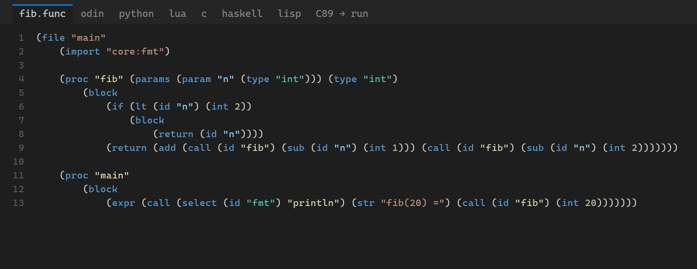
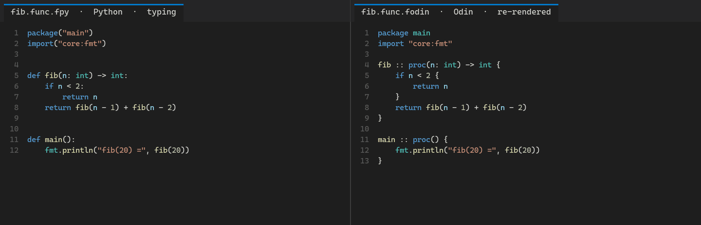

# funC

funC is a small projectional language built around one idea: syntax should not be an excuse to use or avoid a language.

A program is a syntax-independent tree. A **syntax** is a text file that says how that tree is written, and it works both ways: the same rules parse text into the tree and print the tree back out. Pick the notation that suits you, your team or your domain, and everyone still edits the same program.



*One program, stored once as [examples/fib.func](examples/fib.func), shown in each built-in syntax with the editor's highlighting, then compiled to C89 and run. Rendered from the real tools by [docs/demo.py](docs/demo.py).*



*Editing one view re-renders the others: typing into the Python view (left) while the Odin view of the same tree (right) is printed again on every keystroke. A half-typed line stays as typed until it parses. Then the right side shows the same tree as Lua, Haskell, Lisp and C. Rendered by [docs/rerender.py](docs/rerender.py).*

## Why

Traditional languages bind their semantics to one fixed textual grammar. That creates friction:

- Two people may want different notations for the same operation.
- A domain-specific syntax usually means implementing a whole new language.
- Converting between languages loses structure or relies on fragile text transformations.

funC draws the boundary somewhere else: syntax is a replaceable layer, and the tree underneath is shared.

## Quick start

Install the [Odin compiler](https://odin-lang.org/), then from the repository root:

```text
./install.ps1                                  # build everything, install the VS Code extension
bin/funC.exe print examples/fib.func python    # the program in another syntax
bin/funC.exe c89 examples/fib.func fib.c       # compile to C89
```

In VS Code, reload the window and open [examples/fib.func](examples/fib.func). A view opens beside it in your default syntax, and **funC: Switch View Syntax…** picks another. You can edit and save any view.

## The language

Small, but complete enough for real programs:

- **Values:** `int`, `bool` (`true`, `false`) and `string`.
- **Operators:** `+ - * / %`, comparisons, `and`/`or`/`not` and unary minus. They bind the same way in every syntax, like C.
- **Statements:** variables, assignment, `if`/`else`, `while`, `return` and calls.
- **Procedures:** typed parameters and an optional result. Packages are imported, and `core:fmt` gives `print` and `println`.

After parsing, a **checker** reports errors in words that fit any syntax:

- undefined names and unknown packages or members
- type errors (`adding needs two ints, got an int and a bool`)
- calls with the wrong arguments
- a procedure that doesn't return on every path

A **C89 backend** compiles a checked tree to a single C file that builds with `-std=c89 -pedantic -Wall -Wextra -Werror`.

## Syntaxes

Each node kind has a fixed set of **fields** (an `if` has a `condition`, `then` and an optional `otherwise`). A syntax file has one rule per kind. Here are some from the C-like one:

```text
proc   = [result ' ' else 'void '] name '(' parameters*', '|'void' ') ' body
if     = 'if (' condition ') ' then [' else ' otherwise]
add    = left ' + ' right
```

- `'…'` is literal text, and a bare word is a field.
- `parameters*', '` is a list with its separator, and `|'void'` is how an empty one is written.
- `[…]` holds parts that only appear when the fields inside are set. `else 'void '` is what's written when they aren't.
- Syntax files spell operators but never say where parentheses go. That follows from the core's precedence, so `(a + b) * c` keeps its parentheses in every syntax that needs them.

The loader checks that each rule uses every field exactly once, so converting between syntaxes loses nothing. A kind a syntax doesn't spell is written in its tree form, so a new syntax can start with a few rules. Blank lines you type are kept, and `spacing` puts blank lines around procedures. The full format is documented at the top of [syntaxes/c.syntax](syntaxes/c.syntax).

| Syntax | Extension | |
|---|---|---|
| `func` | `.func` | The tree itself, as s-expressions: how programs are stored |
| `odin` | `.fodin` | Odin-like, `for cond { }` loops |
| `c` | `.fc` | C-like |
| `lua` | `.flua` | Lua-like, with Luau-style type annotations |
| `python` | `.fpy` | Python-like, indented blocks, `x := 1` declares |
| `haskell` | `.fhs` | Haskell-like, calls by juxtaposition, `x <- 2` assigns |
| `lisp` | `.flisp` | Lisp-like, everything is a list |

A line that doesn't parse is kept in the tree as an `unparsed` node with its text, so a half-written program can still be shown in every syntax and saved.

## Files and views

A program is stored as a `.func` file: its tree, in the `func` syntax. You edit it through a **view**, the same tree in another syntax, as an editable virtual document (`fib.func.fpy`). Saving a view writes the tree back to the `.func` file, and other open views refresh.

## VS Code

`./install.ps1` builds the language server and the command-line tool, bundles the server into the extension in [editors/vscode/](editors/vscode/), and installs it. Run it again after changing the server or the extension, then reload the window.

- **Views:** **funC: Switch View Syntax…** (the preview button in the editor title bar, or the status bar item) picks another syntax. **funC: View as C** and the other `View as` commands switch directly.
- **Highlighting** comes from the language server. The parser records what every piece of text is, so `.func` files and views in any syntax are coloured, including syntaxes you write. `.syntax` files have a grammar of their own.
- **Diagnostics** for parse and type errors appear as you type, in views and `.func` files alike.
- **funC: Compile to C89** opens the C output of the current file or view.
- **Your own syntaxes:** put `.syntax` files in a `syntaxes` folder in your workspace, or list folders in the `funC.syntaxDirectories` setting. While you edit one, its errors show as diagnostics. Once it's valid it's used straight away, and open views re-render.

For extension development, start the **funC extension** launch configuration (F5) instead.

## Command line

```text
bin/funC.exe syntaxes                          # list the syntaxes
bin/funC.exe check examples/fizzbuzz.func      # parse and check, print diagnostics
bin/funC.exe print examples/fib.func lisp      # the program in another syntax
bin/funC.exe highlight examples/fib.func lua   # the same, as JSON with highlighting tokens (without a syntax: the file as it is)
bin/funC.exe c89 examples/fib.func fib.c       # compile to C89
```

A file's extension picks its syntax, so `bin/funC.exe c89 fib.fpy` compiles a Python-style file directly. `--syntaxes <dir>` loads your own syntax files, and a name that's already taken replaces the built-in one.

## Design

The implementation follows data-oriented habits:

- **Nodes are flat, `#soa` arrays indexed by `u32`.** Hot fields (kind, atom, slots) are separate from cold ones (source spans, flags), so a scan over node kinds touches one byte per node. Names are interned atoms, and lists are count-prefixed runs in one shared array.
- **Memory is arenas.** A tree owns one arena (nodes, names, diagnostics, tokens, its source text), and the editor resets it on every keystroke instead of allocating anew. Temporary work in the parser, checker, syntax loader and backend uses a thread-local scratch arena with savepoints, and nothing allocated there outlives the call.
- **Syntaxes are data.** One small loop interprets rules both to parse and to print. Precedence, reserved words and longest-match symbols are worked out once, when a syntax loads.
- **Side tables instead of fat nodes.** The checker writes each expression's type into a `types` column, and the parser records highlighting tokens in another. Backends and the editor read those.

## Layout

| Path | What |
|---|---|
| [lang/](lang/) | The core: tree, parser, printer, diagnostics, syntax loader, checker and highlighting |
| [syntaxes/](syntaxes/) | Built-in syntaxes, embedded into every binary at compile time |
| [backends/c89/](backends/c89/) | The C89 backend |
| [cli/](cli/) | The `funC` command-line tool |
| [lsp/](lsp/) | The language server |
| [editors/vscode/](editors/vscode/) | The VS Code extension |
| [examples/](examples/) | Example programs |
| [docs/](docs/) | The demo and the script that renders it |

## Development

```text
odin test lang                       # core tests
odin test backends/c89               # backend tests
mkdir bin                            # the linker does not create it
odin build lsp -out:bin/funC-lsp.exe
node lsp/smoke_test.mjs              # drives the server over stdio like an editor
python docs/demo.py                  # re-render docs/demo.gif (needs Pillow and a C compiler)
python docs/rerender.py              # re-render docs/rerender.gif
```

The server uses full-document sync. It publishes parse and semantic diagnostics, answers `textDocument/semanticTokens/full`, and loads `.syntax` documents as syntaxes as you type. Its custom requests:

| Request | Params | Result |
|---|---|---|
| `funC/syntaxes` | | `[{name, title, extension}]` |
| `funC/convert` | `{text, from, to}` | `{ok, text, diagnostics}`: used to render and save views |
| `funC/compile` | `{text, from}` | `{ok, text, errors}`: C89 output |

When a `.syntax` document becomes valid, the server sends a `funC/syntaxesChanged` notification.

## Direction

See [TODO.md](TODO.md). The long-term goal is a language where notation is customizable, semantics are shared, and syntax choice does not decide whether the language is usable.
